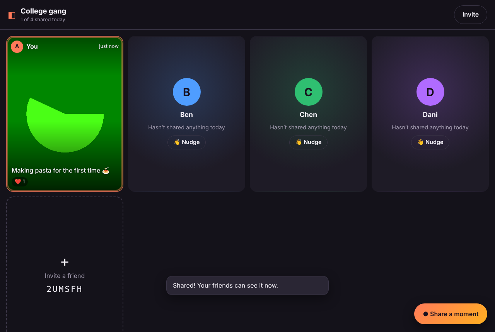
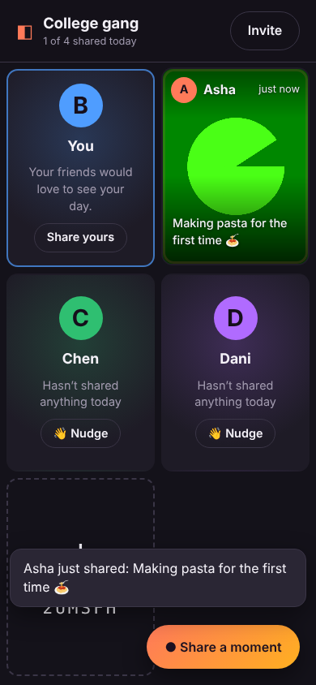
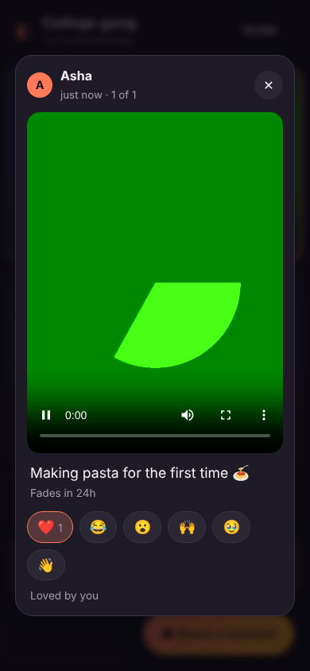

# Friends Wall

**All your friends, in one frame.**

As we get older we drift apart. Everyone's busy, nobody posts, and "we should catch up" never happens. Friends Wall is one small thing to fix that. Each friend shares a few seconds of video of what they're doing right now: cooking, walking the dog, stuck in traffic. The whole circle sees everyone's latest moment playing side by side on one screen.

| Desktop wall | Phone | Watching a moment |
|---|---|---|
|  |  |  |

## What it does

- **Circles**: start a private circle ("College gang", "The cousins") and share the invite link or 6-letter code. No accounts or passwords; you just type your name.
- **One frame**: every friend gets a tile. Each tile loops that friend's latest clip, silently, all at the same time, so you see everyone's day at a glance.
- **Share a moment**: record up to 15 seconds from your phone or laptop camera (front or back), or upload a clip. Add a caption.
- **Tap to watch**: open a tile to play with sound and step through that friend's moments from today.
- **React**: ❤️ 😂 😮 🙌 🥹 👋, and see who reacted.
- **Nudge**: if a friend hasn't shared today, send a 👋 so they know you're thinking of them.
- **Live**: new moments, reactions and new friends show up instantly, with no refresh (Server-Sent Events).
- **Low pressure**: moments disappear after 24 hours. You can remove your own any time.
- Works on phones (installable as a home-screen app) and desktop. No build step, no dependencies.

## Friends Street (the main app now)

The pixel-art street from [docs/IDEAS.md](docs/IDEAS.md) is the main app at `/`. It needs no accounts:

- Open `/` to look around a demo street with sample friends, or start a street for your group.
- Starting a street gives an invite link like `/s/ABC123`. Anyone who opens it types a name, makes a little character, and moves in. Their browser remembers them.
- Every day it asks "what are you up to?". Answers show up in each friend's window on everyone's screen, live.
- Send flowers, chocolates or a "how are you?". The receiver watches the sender walk over, and can write back. The server only gives a gift to the person it's for.
- Drive down the street, past shops, stopping at each friend's place. Change the sky (follows your time of day, or pick rain or blossom).

The original video wall is still at `/wall` (and `/c/CODE` links).

A new street gets up to 4 sample **neighbors** (Rosa, Theo, Nana Jo and Kai, marked "NEIGHBOR") so it doesn't feel empty. They move out one by one as real friends move in, and are all gone once 6 friends live there.

Limits of this trial version: anyone with a street's link can move in, there's no way to remove someone yet, and a person who switches browser or device moves in again as a new neighbor.

## Put it online for free (Render + Upstash)

[render.yaml](../render.yaml) at the repo root deploys this folder as a free Render web service. Render's free plan wipes local files on every restart or sleep, so the street is saved in a free Upstash Redis database instead. The server does this automatically when `UPSTASH_REDIS_REST_URL` and `UPSTASH_REDIS_REST_TOKEN` are set, and it refuses to start if it can't reach that storage, rather than starting with an empty street. See the deploy steps in [DEPLOY.md](DEPLOY.md).

## Run it

Requires Node.js 18 or newer.

```bash
cd friends-wall
npm start
```

Open http://localhost:3000. Port and storage location can be changed:

```bash
PORT=8080 DATA_DIR=/var/lib/friends-wall npm start
```

Run the tests:

```bash
npm test
```

### Using it with real friends

Browsers only allow camera access on **HTTPS** (or `localhost`). To share it with friends, deploy it somewhere that gives you HTTPS and a persistent disk. Options include a small VPS behind Caddy or nginx, or a host such as Fly.io or Render with a volume mounted at `DATA_DIR`. For a quick test from your phone on the same Wi-Fi, a tunnel like `cloudflared` or `ngrok` gives you a temporary HTTPS URL. Check each service's current docs for setup steps.

## How it's built

```
server.js           Node http server: JSON API, video upload/streaming (byte ranges for iOS), live events, 24h cleanup
public/index.html   Page shell + the viewer and recorder dialogs
public/app.js       The app: routing, wall grid, recorder (MediaRecorder), viewer, reactions, live updates
public/styles.css   Styles (mobile-first, dark)
test/api.test.js    API tests (node:test)
data/               Created at runtime: db.json + uploaded videos (git-ignored)
```

### Privacy and security notes

This is a first version for small, trusted groups:

- Anyone with the invite link can join the circle, so share it only with people you trust.
- Your identity is a random token stored in your browser. If you clear browser data you'll rejoin as a new person.
- Videos are stored unencrypted on the server's disk and deleted after 24 hours.
- There is no rate limiting yet. Put it behind a reverse proxy with limits before exposing it publicly.

## Ideas for next steps

- **Live mode**: drop into a real-time video hangout with whoever is online (WebRTC).
- Push notifications when a friend shares or nudges you.
- A daily "what are you up to?" prompt at a random time.
- Circle admins, removing members, and rotating the invite code.
- An opt-in "memories" archive instead of 24-hour expiry.
