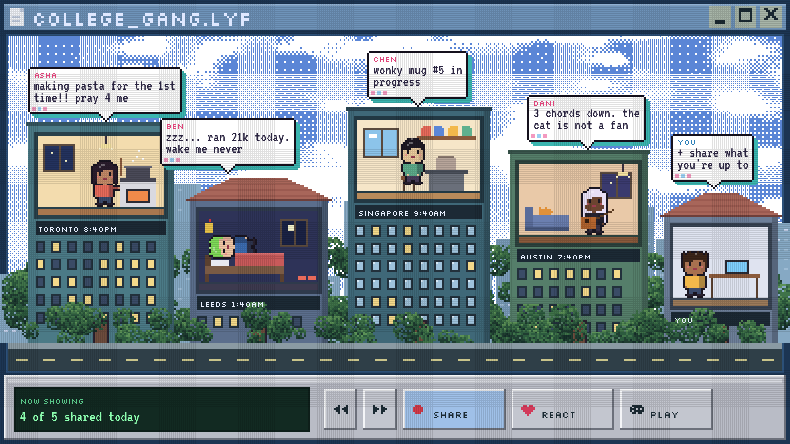
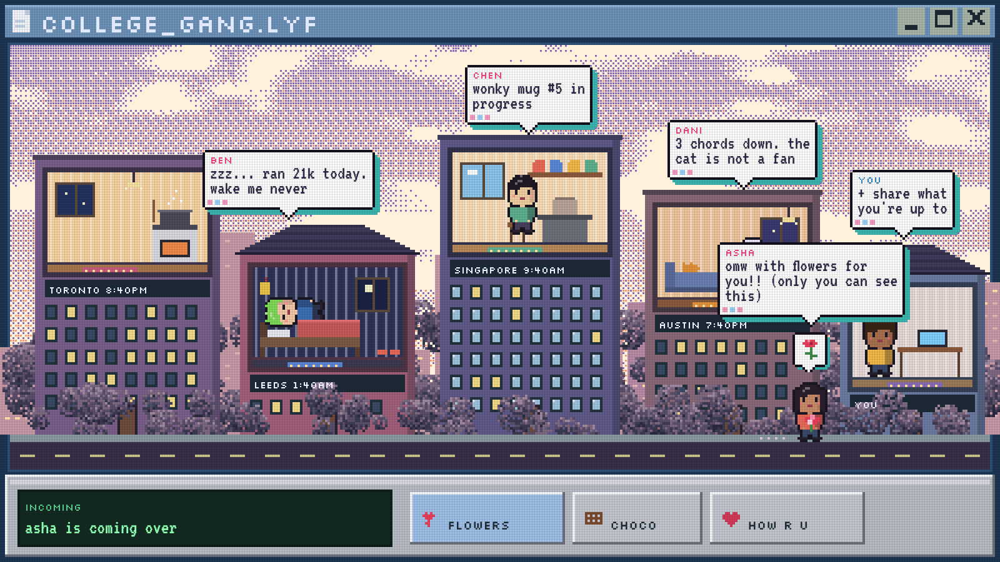
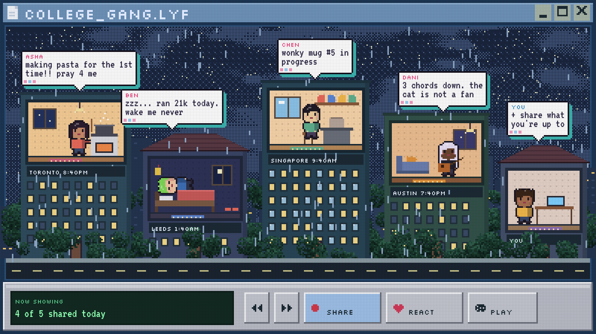
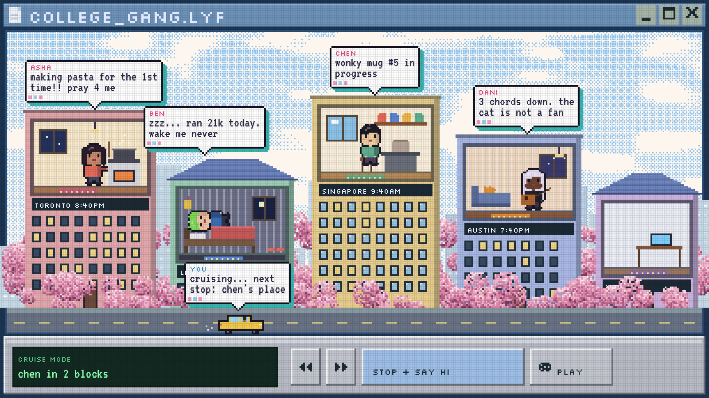
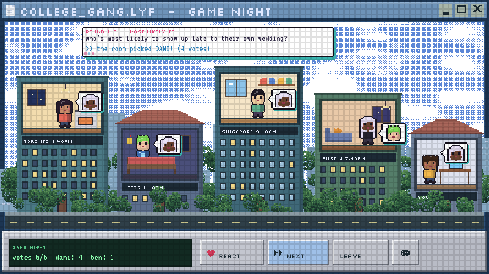
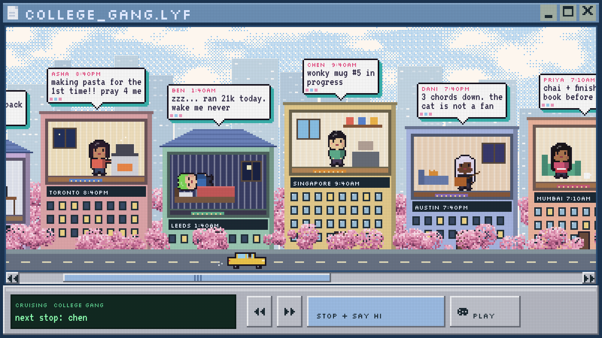
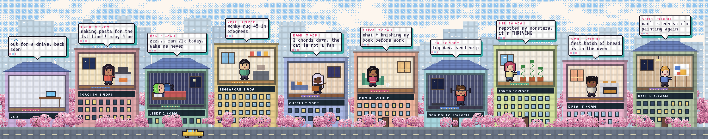
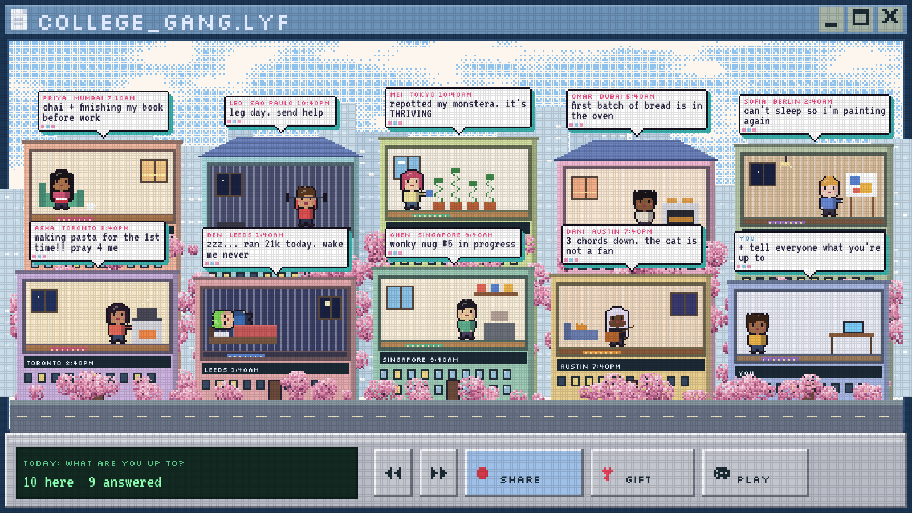
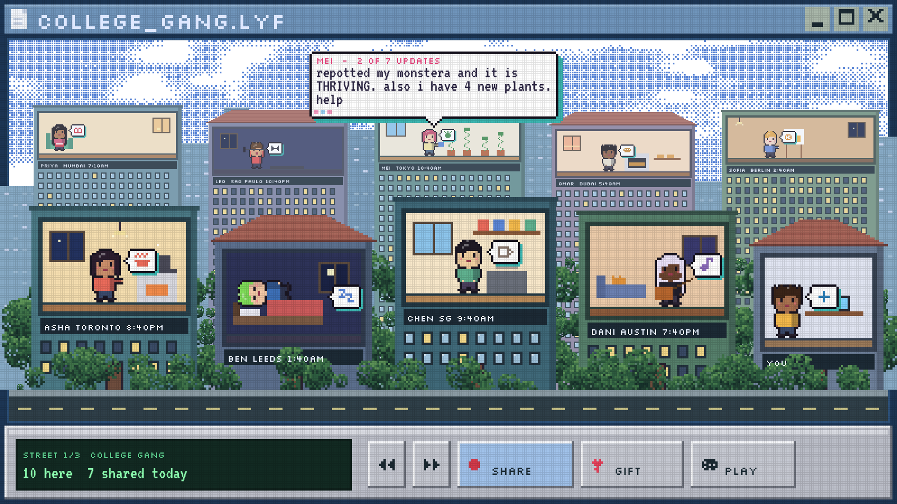

# Friends Wall ideas

The ideas we've collected while designing Friends Wall, with mockups. The mockups use made-up example friends and messages.

## 1. The pixel street (the main view)

A 90s pixel-art look. The whole app is one window, like an old desktop program, with a media-player style control bar at the bottom. Each friend lives in their own building on one street. Their room is cut open so you can see what they're doing.

- **Dialogue boxes** show what each friend is up to. They're white boxes with a teal shadow and a pixel font.
- **The daily question:** when a friend opens the app, or a new day starts for them, they're asked "what are you up to?". Their answer becomes their dialogue box, and their clip or photo can play inside their room.
- **Local time:** each room shows the friend's own local time and the view from their window, such as night in Leeds or morning in Singapore.
- **Characters** are small chibi pixel people with big heads, each in their own pose: cooking, sleeping, playing guitar, painting and so on.

## 2. Sky and weather

The sky is drawn with a dot-matrix dither. It follows the viewer's local time of day, with weather such as rain or clear skies. Users could pick a look themselves, or it could change now and then on its own. Real local weather would need an outside weather service.

| Sunset | Rainy night | Spring |
|---|---|---|
|  |  |  |

The colorful pastel buildings from the spring version are the favorite. They can still shift with the weather.

## 3. Game night

Everyone plays from their own room. A big question box appears in the sky. Votes and answers show up as small bubbles beside each friend, with faces or icons inside. Games so far: "Most likely to…", "Two truths and a lie", and maybe "Remember when…" with old photos.

## 4. Gifts: flowers, chocolates, "how are you?"

A friend taps a gift button. The person receiving it watches the sender's character walk (or drive) down the street to their building carrying flowers or chocolates, or bringing a "how are you?". Only the receiver sees the delivery.

## 5. Driving: the street as a passive game

You're in a car or truck, always cruising. You pass random bakeries and shops, and your friends' places. You can stop at a friend's place to check how they are. They reply, and you keep going. It's relaxing, low effort and always moving.

## 6. Groups and bigger groups

Each group of friends (college gang, cousins, work friends) gets its own street, and you switch streets from the control bar. For bigger groups there are two layouts to choose between:

**A. One long street that scrolls sideways.** Everyone is in one row and the street scrolls, which fits naturally with driving.

**B. Two rows on one screen.** Both rows are the same size, a midpoint between the original front and back sizes. With every dialogue box showing, the front row's boxes cover the bottom of the back row's rooms a little.

An earlier depth version had a smaller, hazy back row and small icon bubbles in each room, with one rotating dialogue box. It's kept for reference:

If the back row were the same size as the front row, two rows of rooms plus dialogue boxes would need about 20 more pixels of height than the window has.

## Still to decide

- Scrolling street (A) or two rows (B) for big groups
- Which sky and weather looks to offer first
